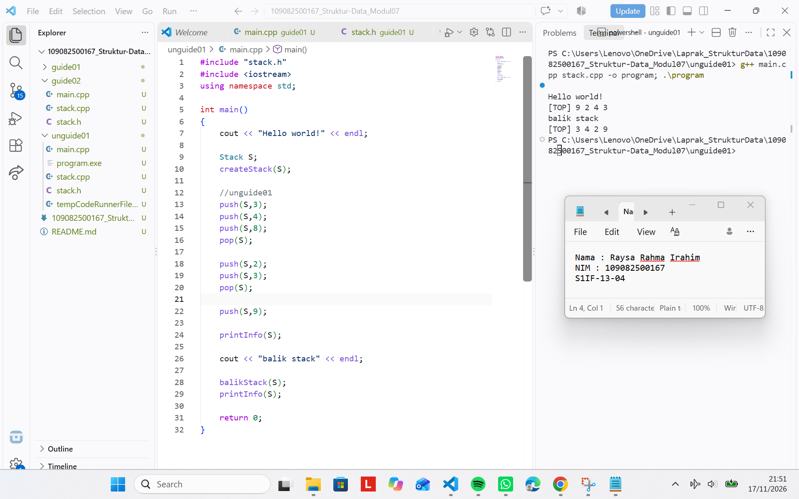
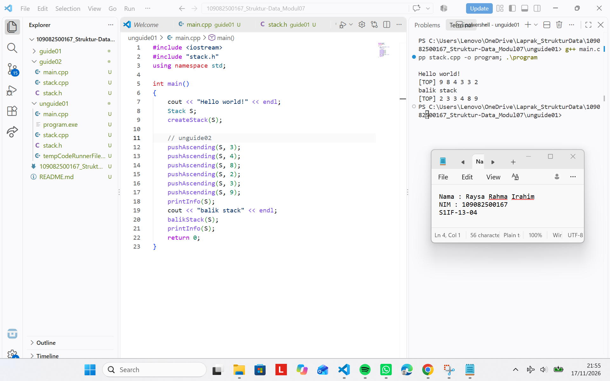
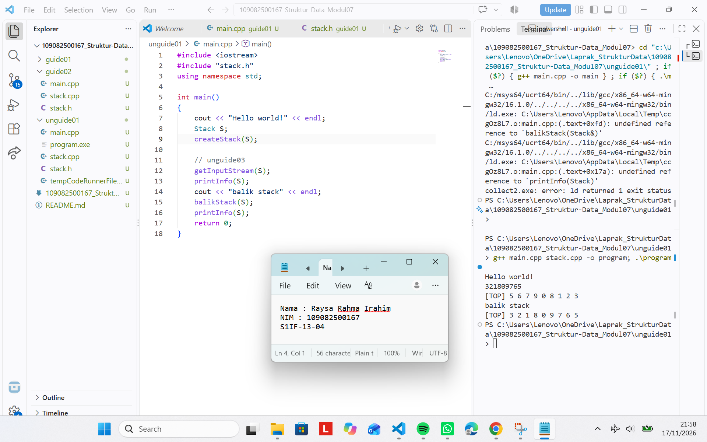

# <h1 align="center"> Laporan Praktikum Modul 7 - STACK </h1>

<p align="center"> Raysa Rahma Irahim - 109082500167 </p>

## Dasar Teori
### A. Konsep Stack<br/>
Stack adalah struktur data yang cara kerjanya seperti tumpukan. Elemen yang bisa diambil lebih dulu adalah elemen yang paling atas, yaitu elemen yang terakhir kali dimasukkan. Prinsip ini disebut LIFO (Last In First Out) [1][2]. Komponen stack sama dengan singly linked list, bedanya akses hanya boleh lewat elemen paling atas yang ditunjuk oleh pointer Top [1].
### 1. Struktur Data<br/>
Ada dua cara merepresentasikan stack. Yang pertama dengan pointer, di mana elemen dideklarasikan dengan struct elmStack yang isinya info dan next, sedangkan stack-nya cuma berisi satu pointer yaitu Top, dan stack dianggap kosong kalau Top bernilai Nil [1]. Yang kedua dengan tabel (array), di mana stack berisi array info dan sebuah variabel integer Top yang menunjuk indeks elemen paling atas. Jumlah elemennya terbatas sesuai ukuran array (Imax) [1]. Karena memakai array, representasi tabel tidak perlu alokasi dan dealokasi memori [1].

### B. Operasi pada Stack<br/>
### 1. Push<br/>
Push adalah operasi menyisipkan elemen ke tumpukan. Pada representasi pointer, push sama dengan insert first pada list: elemen baru P dibuat dulu dengan alokasi, lalu P->next diisi S.Top, dan S.Top diisi P [1]. Pada representasi tabel, Top digeser satu indeks ke atas (Top = Top + 1) lalu data disimpan pada indeks Top yang baru [1]. Pada array perlu dicek dulu apakah stack sudah penuh supaya tidak melewati batas indeks [2].
### 2. Pop<br/>
Pop adalah operasi mengambil elemen paling atas, mirip delete first pada list. Pada representasi pointer, P diisi S.Top, S.Top dimajukan ke (S.Top)->next, lalu P dikembalikan [1]. Pada representasi tabel, data pada indeks Top disimpan dulu ke variabel sementara, lalu Top dikurangi satu (Top = Top - 1) [1]. Sebelum pop, stack harus dicek dulu apakah kosong [2].
### 3. Primitif Lain<br/>
Primitif stack lebih sedikit dibanding list biasa karena operasinya hanya di elemen paling atas, yaitu createStack, isEmpty, alokasi, dealokasi (untuk representasi pointer), fungsi pencarian, dan primitif pendukung lain seperti view [1]. Untuk membaca input karakter demi karakter, bisa dipakai cin.get() yang membaca satu karakter dari input, termasuk karakter enter [3].

## Guided
### GUIDE 01

### stack.h
```C++
#ifndef STACK_TABLE
#define STACK_TABLE

#include <iostream>
using namespace std;

const int MAX = 10;

struct stackTable
{
    int data[MAX];
    int top;
};

bool isEmpty(stackTable s);
bool isFull(stackTable s);
void createStack(stackTable &s);
void push(stackTable &s, int angka);
void pop(stackTable &s);
void update(stackTable &s, int posisi);
void view(stackTable s);
void searchData(stackTable s, int Data);

#endif
```

### stack.cpp
```C++
#include "stack.h"
#include <iostream>
using namespace std;

bool isEmpty(stackTable s)
{
    return s.top == -1;
}
bool isFull(stackTable s)
{
    return s.top == MAX - 1;
}
void createStack(stackTable &s)
{
    s.top = -1;
}
void push(stackTable &s, int angka)
{

    if (isFull(s))
    {
        cout << "Stack penuh!" << endl;
    }
    else
    {
        s.top++;
        s.data[s.top] = angka;
        cout << "Data" << angka << "berhasil ditambahkan kedalam stack !" << endl;
    }
}

void pop(stackTable &s)
{
    if (isEmpty(s))
    {
        cout << "Stack kosong!" << endl;
    }
    else
    {
        int val = s.data[s.top];
        s.top--;
        cout << "Data" << val << " berhasil dihapus dari stack!" << endl;
    }
}

void update(stackTable &s, int posisi)
{
    if (isEmpty(s))
    {
        cout << "Stack kosong!" << endl;
    }
    if (posisi <= 0)
    {
        cout << "Posisi tidak valid!" << endl;
        return;
    }
    // index = top

    int idx = s.top - (posisi - 1);
    if (idx < 0 || idx > s.top)
    {
        cout << "Posisi " << posisi << " tidak valid!" << endl;
        return;
    }

    cout << "Update data posisi ke-" << posisi << endl;
    cout << "Masukkan angka : ";
    cin >> s.data[idx];
    cout << "Data berhasil diupdate!" << endl;
    cout << endl;
}

void view(stackTable s)
{
    if (isEmpty(s))
    {
        cout << "Stack kosong!" << endl;
    }
    else
    {
        for (int i = s.top; i >= 0; --i)
        {
            cout << s.data[i] << " ";
        }
    }
    cout << endl;
}

void searchData(stackTable s, int data)
{
    if (isEmpty(s))
    {
        cout << "Stack kosong!" << endl;
        return;
    

    cout << "Mencari data " << data << "..." << endl;
    int posisi = 1;
    bool found = false;

    for (int i = s.top; i >= 0; --i)
    {
        if (s.data[i] == data)
        {
            cout << "Data " << data << " ditemukan pada posisi ke-" << posisi << endl;
            cout << endl;
            found = true;
            break;
        }
        posisi++;
    }

    if (!found)
    {
        cout << "Data " << data << " tidak ditemukan didalam stack!" << endl;
        cout << endl;
    }
}

```
### main.cpp
```C++
#include "stack.h"
#include <iostream>

using namespace std;

int main()
{
    stackTable s;
    createStack(s);

    push(s, 1);
    push(s, 2);
    push(s, 3);
    push(s, 4);
    push(s, 5);
    cout << endl;

    cout << "--- Stack setelah push ---" << endl;
    view(s);
    cout << endl;

    pop(s);
    pop(s);
    cout << endl;

    cout << "--- Stack setelah pop 2 kali ---" << endl;
    view(s);
    cout << endl;

    update(s, 2);
    update(s, 1);
    cout << endl;

    cout << "--- Stack setelah update ---" << endl;
    view(s);
    cout << endl;

    searchData(s, 4);
    searchData(s, 9);

    return 0;
}
```

penjelasan singkat guided 1 : Di guided ini stack dibuat pakai array (representasi tabel). Di stack.h ada struct stackTable yang isinya array data berukuran MAX = 10 dan variabel top. top = -1 artinya stack kosong, jadi isEmpty ngecek top == -1 dan isFull ngecek top == MAX - 1. createStack ngisi top dengan -1. Push naikin top lalu nyimpen angka di data[top], sedangkan pop cuma ngurangin top, datanya nggak dihapus dari array tapi nanti ketimpa kalau ada push baru. Dua-duanya ngecek dulu penuh atau kosongnya biar nggak keluar dari batas array.

Fungsi update ngubah data berdasarkan posisi yang dihitung dari atas, jadi posisi 1 itu elemen top. Makanya indeksnya dihitung idx = top - (posisi - 1), terus dicek valid atau nggak sebelum angka barunya diinput. view nampilin isi stack dari top ke bawah, jadi yang paling atas keluar duluan. searchData nyari angka dari top ke bawah juga, sambil ngitung posisinya, dan kalau ketemu langsung dicetak posisinya terus berhenti (break). Kalau nggak ketemu sampai habis, dicetak kalau datanya nggak ada.

Di main.cpp, angka 1 sampai 5 di-push, jadi view-nya 5 4 3 2 1. Habis pop dua kali (5 dan 4 keluar), isinya jadi 3 2 1. Lalu update posisi 2 (angka 2) dan posisi 1 (angka 3) diisi nilai baru dari input. Terakhir dicari angka 4 dan 9, dan dua-duanya nggak ditemukan karena 4 udah ikut ke-pop tadi dan 9 emang nggak pernah dimasukin. 

### GUIDE 02

### stack.h
```C++
#ifndef STACK
#define STACK
#define Nil nullptr

#include <iostream>
using namespace std;

typedef struct node *address;

struct node 
{
    int dataAngka;
    address next;
};

struct stack 
{
    address top;
};

struct stack
{
    address top;
};

bool isEmpty(stack listStack);
void createStack(stack &listStack);
address alokasi(int angka);
void dealokasi(address &node);

void push(stack &listStack, address nodeBaru);
void pop(stack &listStack);
void update(stack &listStack, int posisi);
void view(stack listStack);
void searchData(stack listStack, int data);

#endif
```

### stack.cpp
```C++
#include "stack.h"
#include <iostream>

using namespace std;

bool isEmpty(stack listStack)
{
    if (listStack.top == Nil)
    {
        return true;
    }
    else
    {
        return false;
    }
}

void createStack(stack &listStack)
{
    listStack.top = Nil;
}

address alokasi(int angka)
{
    address nodeBaru = new node;
    nodeBaru->dataAngka = angka;
    nodeBaru->next = Nil;
    return nodeBaru;
}

void dealokasi(address &node)
{
    node->next = Nil;
    delete node;
}

void push(stack &listStack, address nodeBaru)
{
    nodeBaru->next = listStack.top;
    listStack.top = nodeBaru;
    cout << "Node " << nodeBaru->dataAngka << " berhasil ditambahkan kedalam stack!" << endl;
}

void pop(stack &listStack)
{
    address nodeHapus;
    if (isEmpty(listStack) == true)
    {
        cout << "Stack kosong!" << endl;
    }
    else
    {
        nodeHapus = listStack.top;
        listStack.top = listStack.top->next;
        nodeHapus->next = Nil;
        dealokasi(nodeHapus);
        cout << "node " << nodeHapus->dataAngka << " berhasil dihapus dari stack!" << endl;
    }
}

void update(stack &listStack, int posisi)
{
    if (isEmpty(listStack) == true)
    {
        cout << "Stack kosong!" << endl;
    }
    else
    {
        if (posisi == 0)
        {
            cout << "Posisi tidak valid!" << endl;
        }
        else
        {
            address nodeBantu = listStack.top;
            int count = 1;
            bool found = false;
            while (nodeBantu != Nil)
            {
                if (count < posisi)
                {
                    nodeBantu = nodeBantu->next;
                    count++;
                }
                else if (count == posisi)
                {
                    cout << "Update node poisisi ke-" << posisi << endl;
                    cout << "Masukkan angka : ";
                    cin >> nodeBantu->dataAngka;
                    cout << "Data berhasil diupdate!" << endl;
                    cout << endl;
                    found = true;
                    break;
                }
            }
            if (found == false)
            {
                cout << "Posisi " << posisi << " tidak valid!" << endl;
            }
        }
    }
}

void view(stack listStack)
{
    if (isEmpty(listStack) == true)
    {
        cout << "List kosong!" << endl;
    }
    else
    {
        address nodeBantu = listStack.top;
        while (nodeBantu != Nil)
        {
            cout << nodeBantu->dataAngka << " ";
            nodeBantu = nodeBantu->next;
        }
    }
    cout << endl;
}

void searchData(stack listStack, int data)
{
    if (isEmpty(listStack) == true)
    {
        cout << "List kosong!" << endl;
    }
    else
    {
        address nodeBantu = listStack.top;
        int posisi = 1;
        bool found = false;
        cout << "Mencari data " << data << "..." << endl;
        while (nodeBantu != Nil)
        {
            if (nodeBantu->dataAngka == data)
            {
                cout << "Data " << data << " ditemukan pada posisi ke-" << posisi << endl;
                found = true;
                cout << endl;
                break;
            }
            else
            {
                posisi++;
                nodeBantu = nodeBantu->next;
            }
        }
        if (found == false)
        {
            cout << "Data " << data << " tidak ditemukan didalam stack!" << endl;
            cout << endl;
        }
    }
}
```
### main.cpp
```C++
#include "stack.h"
#include <iostream>

using namespace std;

int main()
{
    stack listStack;
    address nodeA, nodeB, nodeC, nodeD, nodeE = Nil;
    createStack(listStack);

    nodeA = alokasi(1);
    nodeB = alokasi(2);
    nodeC = alokasi(3);
    nodeD = alokasi(4);
    nodeE = alokasi(5);

    push(listStack, nodeA);
    push(listStack, nodeB);
    push(listStack, nodeC);
    push(listStack, nodeD);
    push(listStack, nodeE);
    cout << endl;

    cout << "--- Stack setelah push ---" << endl;
    view(listStack);
    cout << endl;

    pop(listStack);
    pop(listStack);
    cout << endl;

    cout << "--- Stack setelah pop 2 kali ---" << endl;
    view(listStack);
    cout << endl;

    update(listStack, 2);
    update(listStack, 1);
    update(listStack, 4);
    cout << endl;

    cout << "--- Stack setelah update ---" << endl;
    view(listStack);
    cout << endl;

    searchData(listStack, 4);
    searchData(listStack, 9);

    return 0;
}
```

penjelasan singkat guided 2 : penjelasan singkat guided 2 : Di guided ini stack dibuat pakai pointer (linked list). Tiap elemen berupa struct node yang isinya dataAngka dan next, sedangkan stack-nya cuma punya satu pointer yaitu top. Stack kosong kalau top == Nil, jadi isEmpty ngecek itu dan createStack ngisi top dengan Nil. Beda sama versi array, di sini memorinya dibuat sendiri: alokasi bikin node baru pakai new dan ngisi dataAngka-nya, dealokasi ngebebasin node pakai delete.

Push itu kayak insert first. Next dari node baru diarahin ke top yang lama, terus top-nya dipindah ke node baru. Pop kebalikannya kayak delete first. Node paling atas ditampung di nodeHapus, top dimajuin ke node berikutnya, terus node yang ditampung tadi dilepas dan didealokasi. Karena stack ini nggak ada batas ukurannya, nggak perlu ada isFull.

Update dan searchData jalannya sama, yaitu pakai nodeBantu yang mulai dari top dan jalan ke bawah lewat next sambil ngitung posisi. Posisi 1 itu node paling atas. Di update, kalau posisinya ketemu angkanya diinput ulang, kalau nodeBantu udah sampai Nil dan posisinya nggak ketemu dicetak “Posisi tidak valid”. Di searchData, kalau dataAngka sama dengan yang dicari langsung dicetak posisinya terus berhenti (break). View nampilin semua isi dari top ke bawah.

Di main.cpp, 5 node (1 sampai 5) dialokasi lalu di-push, jadi view-nya 5 4 3 2 1. Habis dua kali pop (5 dan 4 keluar) isinya 3 2 1. Update posisi 2 dan posisi 1 diisi angka baru dari input, sedangkan update posisi 4 muncul “Posisi 4 tidak valid!” karena stack-nya tinggal 3 node. Terakhir dicari angka 4 dan 9, dua-duanya nggak ditemukan karena 4 udah ke-pop dan 9 emang nggak pernah dimasukin.

## UNGUIDED
### Unguided 1
### 1. Buatlah ADT Stack menggunakan ARRAY di dalam file “stack.h” dengan infotype integer, Stack (info array [20] of integer, top), serta primitif createStack, push, pop (function yang mengembalikan infotype), printInfo, dan balikStack. Buat implementasinya pada file “stack.cpp” dan cobalah pada file “main.cpp”.

### stack.h
```C++
#ifndef STACK_H_INCLUDED
#define STACK_H_INCLUDED

#include <iostream>
using namespace std;

#define MAX 20

typedef int infotype;

struct Stack {
    infotype info[MAX];
    int top;
};

void createStack(Stack &S);
bool isEmpty(Stack S);
bool isFull(Stack S);
void push(Stack &S, infotype x);
infotype pop(Stack &S);
void printInfo(Stack S);
void balikStack(Stack &S);

// unguide 2
void pushAscending(Stack &S, infotype x);

// unguide 3
void getInputStream(Stack &S);

#endif  
```
### stack.cpp
```C++
#include "stack.h"
#include <cctype>

void createStack(Stack &S) {
    S.top = -1;
}

bool isEmpty(Stack S) {
    return S.top == -1;
}

bool isFull(Stack S) {
    return S.top == MAX - 1;
}

void push(Stack &S, infotype x) {
    if (isFull(S)) {
        cout << "Stack penuh!" << endl;
    } else {
        S.top++;
        S.info[S.top] = x;
    }
}

infotype pop(Stack &S) {
    if (isEmpty(S)) {
        cout << "Stack kosong!" << endl;
        return -1;
    }
    infotype x = S.info[S.top];
    S.top--;
    return x;
}

void printInfo(Stack S) {
    cout << "[TOP] ";
    if (isEmpty(S)) {
        cout << "(kosong)";
    } else {
        for (int i = S.top; i >= 0; i--) {
            cout << S.info[i] << " ";
        }
    }
    cout << endl;
}

void balikStack(Stack &S) {
    int i = 0;
    int j = S.top;
    while (i < j) {
        infotype temp = S.info[i];
        S.info[i] = S.info[j];
        S.info[j] = temp;
        i++;
        j--;
    }
}

// unguide 2
void pushAscending(Stack &S, infotype x) {
    if (isFull(S)) {
        cout << "Stack penuh!" << endl;
    } else {
        int i = S.top;
        while (i >= 0 && S.info[i] > x) {
            S.info[i + 1] = S.info[i];
            i--;
        }
        S.info[i + 1] = x;
        S.top++;
    }
}

//unguide 3
void getInputStream(Stack &S) {
    int c = cin.get();
    while (c != '\n' && c != EOF) {
        if (isdigit(c)) {
            push(S, c - '0');
        }
        c = cin.get();
    }
}
```
### main.cpp
```C++
#include "stack.h"
#include <iostream>
using namespace std;

int main()
{
    cout << "Hello world!" << endl;

    Stack S;
    createStack(S);

    // unguide01
    push(S,3);
    push(S,4);
    push(S,8);
    pop(S);

    push(S,2);
    push(S,3);
    pop(S);

    push(S,9);

    printInfo(S);

    cout << "balik stack" << endl;

    balikStack(S);
    printInfo(S);

    // unguide02
    pushAscending(S,3);
    pushAscending(S,4);
    pushAscending(S,8);
    pushAscending(S,2);
    pushAscending(S,3);
    pushAscending(S,9);

    printInfo(S);

    cout << "balik stack" << endl;

    balikStack(S);
    printInfo(S);

    // unguide03
    getInputStream(S);

    printInfo(S);

    cout << "balik stack" << endl;

    balikStack(S);
    printInfo(S);

    return 0;
}
```

### Output Unguided 1 :

### Output Unguided 2 :

### Output Unguided 3 :


penjelasan unguided 01-03 : penjelasan unguided 1-3 : Di unguided ini saya bikin ADT Stack pakai array, dibagi jadi stack.h, stack.cpp, sama main.cpp. Stack-nya punya array info isi 20 dan variabel top. top = -1 artinya stack kosong. Push naikin top lalu simpen datanya di info[top], pop ngambil info[top] terus top-nya diturunin. printInfo nampilin isi dari top ke bawah, jadi yang paling atas keluar duluan. balikStack nuker elemen dari ujung bawah sama ujung atas sampai ketemu di tengah. Di modul tulisannya Push huruf besar dan pop(S) nggak ada titik koma, jadi saya benerin biar bisa dicompile.

Latihan 1 hasilnya [TOP] 9 2 4 3, terus pas dibalik jadi [TOP] 3 4 2 9. Latihan 2 pakai pushAscending: elemen yang lebih gede dari x digeser ke atas dulu, baru x dimasukin, jadi isinya selalu urut dari kecil di bawah ke gede di atas. Hasilnya [TOP] 9 8 4 3 3 2, kalau dibalik [TOP] 2 3 3 4 8 9. Latihan 3 pakai getInputStream yang baca karakter satu-satu pakai cin.get() sampai user tekan enter. Karakternya diubah ke angka pakai c - ‘0’ dulu sebelum di-push, soalnya cin.get() ngasih kode karakter, bukan angkanya. Input 4729601 hasilnya [TOP] 1 0 6 9 2 7 4, dibalik jadi [TOP] 4 7 2 9 6 0 1. Semua output sama kayak contoh di modul.


## Kesimpulan
Dari praktikum modul 7 ini saya belajar bahwa stack adalah struktur data dengan prinsip LIFO, jadi data yang terakhir dimasukkan adalah data yang pertama diambil, dan semua operasinya hanya terjadi di elemen paling atas (Top). Dua operasi utamanya adalah push dan pop. Saya juga jadi paham perbedaan representasi pointer dan tabel. Pointer lebih fleksibel karena ukurannya tidak dibatasi tapi butuh alokasi dan dealokasi, sedangkan tabel lebih sederhana tapi kapasitasnya terbatas sehingga perlu dicek penuh atau tidaknya sebelum push dan kosong atau tidaknya sebelum pop. Di bagian unguided, saya mencoba membuat ADT stack dengan array, membalik isi stack dengan menukar elemen dari dua ujung, membuat pushAscending yang menjaga isi stack tetap terurut, dan membaca input dengan cin.get() lalu mengubah karakter angka menjadi integer sebelum di-push. Pemisahan kode ke file .h, .cpp, dan main.cpp juga bikin program lebih rapi dan primitifnya bisa dipakai ulang di beberapa soal.

## Referensi
[1] Telkom University. (2023). Modul 7 Stack, Modul Praktikum Struktur Data. Fakultas Informatika, Telkom University.<br/> 
[2] GeeksforGeeks. (n.d.). Stack Data Structure. Diakses melalui https://www.geeksforgeeks.org/stack-data-structure/.<br/> 
[3] cppreference.com. (n.d.). std::basic_istream::get. Diakses melalui https://en.cppreference.com/w/cpp/io/basic_istream/get.<br/>